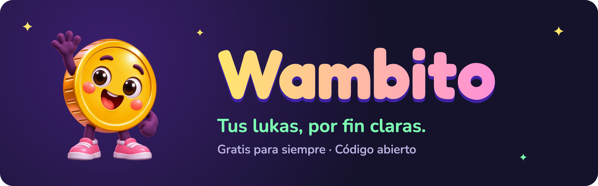

# Wambito

**Your budget, and you'll actually enjoy looking after it.** Log an expense in seconds and see where your money goes: a monthly budget on the web, an Android app with widgets that can log your bank's notifications by itself (iOS on the way), and an MCP server so your AI assistant (Claude, ChatGPT…) can help you with your money.

Wambito is **free forever and open source** ([AGPL-3.0](LICENSE)): anyone can read the code and check what it does with your data.

## Why "Wambito"?

**Wambito** comes from *guambito*, how people in Ibagué and Tolima call a kid. The W spelling is closer to the Quechua *wambra*.

**Wambi is the project's mascot**, a gold coin that keeps you company in the app. It reacts to how your month is going, with short messages when a category is close to or over its limit and when you close the month within budget. The goal is for looking after your money to feel good, not like homework.

The app still talks about money the Colombian way: in Colombia we call money **lukas** (spelled *lucas* in Chile, Argentina and Peru), and one *luka* is a thousand pesos. You will see "Tus lukas, por fin claras" on the Spanish landing page.

## What it does

- **What's left to spend this month**, big and always visible, in the app and on the widget.
- **Monthly budget per category**, with bars that fill up with what you've spent and change color as you approach the limit.
- **Daily transactions**, paid or pending, with automatic recurring ones (rent, subscriptions, salary…).
- **Automatic capture (Android):** the app reads your bank's payment notifications (Revolut, Google Wallet) and logs them for you to review.
- **Voice entry:** say "18 lukas almuerzo" and it is logged, recognized on your phone.
- **Analysis** by category and month-over-month trends.
- **Import your history from other apps:** Budge today (CSV); Buddy and others soon.
- **Connect your assistant:** an MCP server so you can ask your AI to log expenses, prepare reports, or adjust your budget.
- **No passwords:** sign in with a code sent to your email, a passkey, or by scanning a QR on the web with your phone.

## End-to-end encryption

🔒 **On for every account.** Each phone or browser encrypts your movements with a key only you hold; the server keeps only encrypted records, and an assistant gets a key only while you keep it connected. Every account moved over on one switch day, before the public release. How it works, with pictures: [`docs/encryption.md`](docs/encryption.md).

## Status

🚧 In development, used every day at [app.wambito.com](https://app.wambito.com).

| Part | Status |
|---|---|
| API and web app | ✅ live |
| Android app (widgets, automatic capture, voice) | ✅ built; Google Play and F-Droid pending |
| iOS app | 🧪 base built (no capture, widgets or voice yet); App Store after Android |
| MCP server for assistants | ✅ live |
| End-to-end encryption | 🧪 built; switch day pending |
| Accounts without email (phone-first, QR sign-in on the web) | 🧪 built; ships with the encryption switch |
| Import from other apps | ✅ Budge; others soon |

The first design is in [`docs/superpowers/specs/2026-10-20-lukas-design.md`](docs/superpowers/specs/2026-10-20-lukas-design.md); later ones are in [`docs/superpowers/specs/`](docs/superpowers/specs/).

## Architecture

A monorepo with:

- `apps/api`: TypeScript backend (Hono), Postgres and Better Auth
- `apps/web`: React Router + Vite: the landing, the app and a demo
- `apps/mcp`: remote MCP server; opens encrypted accounts in memory
- `apps/mobile`: Flutter, with native Kotlin (Glance widgets, notification capture) and Swift sides
- `packages/core`, `packages/db`, `packages/importers`: business rules, schema and migrations, importers
- `packages/crypto`, `packages/vault`: end-to-end encryption and the encrypted vault with its sync

## Developing

Requirements: Node 22, pnpm 12 and Docker (Flutter for the phone app). Running the stack, the web app and the tests: [`docs/development.md`](docs/development.md). The repo map and its rules: [`AGENTS.md`](AGENTS.md).

## Deploying

- **The landing page** ships on its own as static files (Cloudflare), published by CI after every merge into `main`: [`docs/deploy/landing.md`](docs/deploy/landing.md), with its config in [`deploy/landing/`](deploy/landing/).
- **The app** (web, API, MCP), on a server or a machine at home: [`docs/self-hosting.md`](docs/self-hosting.md), with the full runbook in [`deploy/personal/`](deploy/personal/README.md).
- **The API** on its own: [`docs/deploy/api.md`](docs/deploy/api.md).

## Self-hosting

You can run your own Wambito on a Linux server: the same Docker stack that serves `app.wambito.com`, with the web app, the API for the phone app, the MCP server for assistants and daily backups. The guide, with a prompt you can paste into a coding agent (Claude Code, Codex…) so it installs everything for you: [`docs/self-hosting.md`](docs/self-hosting.md).

## License

[AGPL-3.0](LICENSE). If you offer a modified Wambito as a service, you must publish your changes.

The home and summary tab icons are [Plump Free](https://www.streamlinehq.com/icons/plump) by
Streamline, under [CC BY 4.0](https://creativecommons.org/licenses/by/4.0/); the other interface
icons are Wambito's own (`docs/design/system/project/icons/icons.json`).
